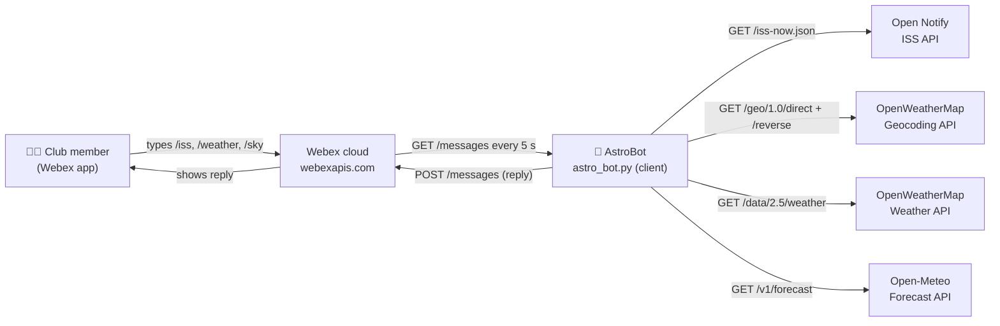

# 🚀 Space Bot API Investigation Sheet

**Total Marks: 40**  
**TASK 1: Collect Required API Documentation**

This investigation sheet helps you gather key technical information from the three APIs required for the Space Bot project: **Webex Messaging API**, **ISS Current Location API**, **Weather API** and a **Geocoding API** , plus the Python time module. Also furhter investigate the application of Web Architecture and MVC design pattern in development of the Bot

---

##  Webex Messaging API (4 marks)

| Criteria | Details |
|---------|---------|
| API Base URL | `https://webexapis.com/v1` |
| Authentication Method | **Bearer token** (OAuth 2.0 access token) sent in the `Authorization` HTTP header. For development I used the *Personal Access Token* from developer.webex.com, which expires 12 hours after signing in to the portal, so it is never hard-coded in the script (it is loaded from a `.env` file). |
| Endpoint to list rooms | `GET /rooms` → `https://webexapis.com/v1/rooms` (optional query params: `max`, `type`, `sortBy`) |
| Endpoint to get messages | `GET /messages?roomId={roomId}&max=1` → returns the newest message first in `items[0]` |
| Endpoint to send message | `POST /messages` with a JSON body containing `roomId` and `text` (or `markdown`) |
| Required headers | `Authorization: Bearer <access_token>` on every request; `Content-Type: application/json` on POST requests |
| Sample full GET or POST request | See the `curl` examples below ↓ |

**Sample GET request – latest message in a room**

```bash
curl -X GET "https://webexapis.com/v1/messages?roomId=<ROOM_ID>&max=1" \
     -H "Authorization: Bearer <YOUR_WEBEX_TOKEN>"
```

**Sample POST request – send a message to a room**

```bash
curl -X POST "https://webexapis.com/v1/messages" \
     -H "Authorization: Bearer <YOUR_WEBEX_TOKEN>" \
     -H "Content-Type: application/json" \
     -d '{"roomId": "<ROOM_ID>", "text": "Hello from AstroBot 🚀"}'
```

**Sample JSON response – `GET /rooms`** (IDs shortened)

```json
{
  "items": [
    {
      "id": "Y2lzY29zcGFyazovL3VzL1JPT00v...",
      "title": "Astro Club Room",
      "type": "group",
      "isLocked": false,
      "lastActivity": "2026-10-22T21:15:03.120Z",
      "creatorId": "Y2lzY29zcGFyazovL3VzL1BFT1BMRS8...",
      "created": "2026-10-22T20:58:41.512Z",
      "isPublic": false,
      "isReadOnly": false
    }
  ]
}
```

**Sample JSON response – `GET /messages?roomId=...&max=1`**

```json
{
  "items": [
    {
      "id": "Y2lzY29zcGFyazovL3VzL01FU1NBR0Uv...",
      "roomId": "Y2lzY29zcGFyazovL3VzL1JPT00v...",
      "roomType": "group",
      "text": "/weather London",
      "personId": "Y2lzY29zcGFyazovL3VzL1BFT1BMRS8...",
      "personEmail": "student@example.com",
      "created": "2026-10-22T21:15:03.120Z"
    }
  ]
}
```

---

##  ISS Current Location API (2 marks)

| Criteria | Details |
|---------|---------|
| API Base URL | `http://api.open-notify.org` (HTTP only – no authentication or API key required) |
| Endpoint for current ISS location | `GET /iss-now.json` → `http://api.open-notify.org/iss-now.json` |
| Sample response format (example JSON) | See below ↓ |

```json
{
  "message": "success",
  "timestamp": 1792704600,
  "iss_position": {
    "latitude": "-12.4931",
    "longitude": "98.2275"
  }
}
```

**Notes from the documentation / testing**

- `timestamp` is a **Unix epoch** (seconds since 1 Jan 1970 UTC) and must be converted to a readable date/time.
- `latitude` and `longitude` are returned as **strings**, so they are converted with `float()` before being passed to the reverse geocoding API.
- The documentation asks clients to poll **no more than about once every 5 seconds** – this matches the 5-second polling loop in the bot.
- The API is served over plain HTTP, so the response is not encrypted (acceptable here because it contains no sensitive data and no key is sent).

---

##  Geocoding API (4 marks)

| Criteria | Details |
|---------|---------|
| Provider used (Choose one) | **OpenWeatherMap Geocoding API** – chosen because it uses the same API key as the Weather API, so the bot only has to manage one key for both services. |
| API Base URL | `https://api.openweathermap.org/geo/1.0` |
| Endpoint for geocoding | `GET /direct?q={city name},{state code},{country code}&limit={n}&appid={API key}` (city name → lat/lon) |
| Endpoint for reverse geocoding | `GET /reverse?lat={lat}&lon={lon}&limit={n}&appid={API key}` (lat/lon → place name) |
| Authentication method | API key passed as the `appid` **query parameter** |
| Required query parameters | **Direct:** `q`, `appid` (`limit` optional, max 5). **Reverse:** `lat`, `lon`, `appid` (`limit` optional) |
| Sample request with latitude/longitude | `https://api.openweathermap.org/geo/1.0/reverse?lat=51.9022&lon=-0.2026&limit=1&appid=YOUR_API_KEY` |
| Sample JSON response (formatted example) | See below ↓ |

```json
[
  {
    "name": "Stevenage",
    "local_names": {
      "en": "Stevenage"
    },
    "lat": 51.9016663,
    "lon": -0.2027155,
    "country": "GB",
    "state": "England"
  }
]
```

**Notes:** the response is a JSON **array** (list), not an object, so the bot reads the first result with `data[0]`. When the coordinates are over the ocean the API returns an empty list `[]`, which the bot handles by showing *"Over Ocean / No Nearby City"*.

---


##  Weather API (3 marks)

| Criteria | Details |
|---------|---------|
| API Provider (Choose one) | **OpenWeatherMap – Current Weather Data API** (free tier) |
| API Base URL | `https://api.openweathermap.org/data/2.5` |
| Endpoint for current weather | `GET /weather?lat={lat}&lon={lon}&units=metric&appid={API key}` |
| Authentication method | API key passed as the `appid` **query parameter** |
| Required query parameters | `lat`, `lon`, `appid` (required); `units=metric` (optional – returns °C and m/s instead of Kelvin) |
| Sample JSON response (formatted example) | See below ↓ |

```json
{
  "coord": { "lon": -0.2027, "lat": 51.9017 },
  "weather": [
    { "id": 803, "main": "Clouds", "description": "broken clouds", "icon": "04n" }
  ],
  "base": "stations",
  "main": {
    "temp": 9.4,
    "feels_like": 7.9,
    "temp_min": 8.6,
    "temp_max": 10.1,
    "pressure": 1012,
    "humidity": 84
  },
  "visibility": 10000,
  "wind": { "speed": 3.6, "deg": 240 },
  "clouds": { "all": 75 },
  "dt": 1792704600,
  "sys": {
    "country": "GB",
    "sunrise": 1792650900,
    "sunset": 1792688100
  },
  "timezone": 3600,
  "id": 2636638,
  "name": "Stevenage",
  "cod": 200
}
```

**Fields used by AstroBot:** `name`, `sys.country`, `main.temp`, `weather[0].description`, `main.humidity`, `wind.speed`, plus `clouds.all` (cloud cover %) and `visibility` (metres) to judge whether the sky is clear enough for stargazing. `dt`, `sunrise` and `sunset` are epoch timestamps; `timezone` is the offset from UTC in seconds.

---

##  Epoch to Human Time Conversion (Python time module) (2 marks)

| Criteria | Details |
|---------|---------|
| Library used | `time` (Python standard library – no installation needed) |
| Function used to convert epoch | `time.gmtime()` converts the epoch seconds into a UTC time structure, then `time.strftime()` formats it as readable text (`time.ctime()` is a quicker alternative that uses the computer's local time) |
| Sample code to convert timestamp | See below ↓ |
| Output (human-readable time) | `Thu 22 Oct 2026, 21:30 UTC` |

```python
import time

timestamp = 1792704600   # "timestamp" field from the ISS API response
readable = time.strftime("%a %d %b %Y, %H:%M", time.gmtime(timestamp))
print(readable, "UTC")   # -> Thu 22 Oct 2026, 21:30 UTC
```

**How it is used in AstroBot:** the `format_epoch(epoch, utc_offset=0)` function in `astro_bot.py` does this conversion for the ISS `timestamp` (shown in UTC) and for the Weather API `dt` and `sunset` values. For weather, the API's `timezone` offset (in seconds) is added first so the time shown is the **local time of that city**. If a timestamp is missing, the function returns `"Unknown"` instead of crashing.

---

##  Extended Feature API ( 3 marks)

**Command added:** `/sky <city>` – tonight's stargazing forecast: average cloud cover after dark, the **best hour to observe**, sunset/sunrise times and the **moon phase**.

| Criteria | Details |
|---------|---------|
| API Provider | **Open-Meteo** (open-meteo.com) – free weather forecast API for non-commercial use |
| API Base URL | `https://api.open-meteo.com/v1` |
| Endpoint | `GET /forecast` |
| Authentication method | **None** – no API key or account is required (free tier allows fewer than 10,000 calls per day) |
| Required query parameters | `latitude`, `longitude` (required). Also used: `hourly=cloud_cover,visibility,is_day`, `daily=sunrise,sunset`, `timezone=auto` (times in the city's local time), `forecast_days=2` |
| Sample request | `https://api.open-meteo.com/v1/forecast?latitude=51.90&longitude=-0.20&hourly=cloud_cover,visibility,is_day&daily=sunrise,sunset&timezone=auto&forecast_days=2` |
| Sample JSON response (formatted example) | See below ↓ (hourly lists shortened to 3 values) |

```json
{
  "latitude": 51.9,
  "longitude": -0.2,
  "utc_offset_seconds": 3600,
  "timezone": "Europe/London",
  "timezone_abbreviation": "BST",
  "hourly_units": { "time": "iso8601", "cloud_cover": "%", "visibility": "m", "is_day": "" },
  "hourly": {
    "time": ["2026-10-23T00:00", "2026-10-23T01:00", "2026-10-23T02:00"],
    "cloud_cover": [80, 10, 10],
    "visibility": [24140.0, 24140.0, 24140.0],
    "is_day": [0, 0, 0]
  },
  "daily_units": { "time": "iso8601", "sunrise": "iso8601", "sunset": "iso8601" },
  "daily": {
    "time": ["2026-10-23", "2026-10-24"],
    "sunrise": ["2026-10-23T07:37", "2026-10-24T07:39"],
    "sunset": ["2026-10-23T17:52", "2026-10-24T17:50"]
  }
}
```

**Why Open-Meteo was chosen:**
- OpenWeather's free current-weather endpoint only describes the sky *right now*, but the club plans events for *tonight*. Open-Meteo gives an **hourly** cloud forecast, so the bot can recommend the best hour to observe.
- It needs **no API key**, so there is no extra secret to store or leak.
- It reuses the existing `get_city_coordinates()` function, so the city lookup stays consistent with `/weather`.

**Moon phase:** calculated in the code by `get_moon_phase()` (no API needed) – it measures how many days have passed since a known new moon (6 Jan 2000) and divides by the 29.53-day lunar cycle. This was checked against real dates: new moon on 10 Oct 2026 and full moon on 26 Oct 2026.

**Example `/sky Stevenage` reply:**

```
🌌 Tonight's sky for Stevenage, GB
🌇 Sunset: 17:52  |  🌅 Sunrise: 07:39 (local time)
☁️ Average cloud cover tonight: 64%
⭐ Best time to look up: 01:00 (cloud 10%, visibility 24 km)
🌙 Moon: Waxing Gibbous 🌔 (93% lit)
🔭 Verdict: Good ✅ - clear spell around 01:00 (bright moon will hide faint stars)
```

--- 

##  Evaluation – Web Architecture, MVC Design & Security 

---

###  Web Architecture – Client–Server Model (3 marks)

**Client:** the AstroBot Python script (`astro_bot.py`) is an **HTTP client**. It never serves pages itself; it sends requests to other servers and reads their responses. The club members' Webex apps (phone or desktop) are also clients of the Webex cloud.

**Servers:**
| Server | What it provides to AstroBot |
|--------|------------------------------|
| Webex cloud – `webexapis.com` | Stores rooms and messages; the bot reads commands from it and posts replies to it |
| Open Notify – `api.open-notify.org` | Current ISS latitude, longitude and timestamp |
| OpenWeatherMap – `api.openweathermap.org` | Geocoding (city ↔ coordinates) and current weather |
| Open-Meteo – `api.open-meteo.com` | Hourly cloud forecast, sunrise and sunset for `/sky` |

**Data flow (example: `/iss`):**
1. A club member types `/iss` in the Webex room → the Webex app sends it to the Webex cloud.
2. AstroBot polls the cloud every 5 seconds with `GET /messages?roomId=…&max=1` and sees a new message starting with `/`.
3. AstroBot sends `GET /iss-now.json` to Open Notify and receives the coordinates as JSON.
4. AstroBot sends the coordinates to OpenWeatherMap: `GET /geo/1.0/reverse` (place name) and `GET /data/2.5/weather` (weather below the ISS).
5. AstroBot formats one readable message and sends it with `POST /messages` → Webex shows it to every member in the room.

**Block diagram:**



####  Security Considerations: (3 marks )

**1. Secure handling of API keys and tokens**
- The Webex token and OpenWeather key are **never written in the code**. They are stored in a local `.env` file and loaded with `python-dotenv`; `.gitignore` contains `.env`, so the secrets are never pushed to GitHub.
  ```python
  token = os.getenv("WEBEX_TOKEN", "")
  weather_key = get_api_key("Weather API key", os.getenv("OPENWEATHER_API_KEY", ""))
  ```
- If a key is typed in manually, `getpass()` is used so it is **not displayed on screen** (important when screen-sharing or recording).
- The Webex token is sent in the `Authorization: Bearer` header over **HTTPS**, so it is encrypted in transit. The personal access token expires after 12 hours, which limits the damage if it leaks; the bot prints a clear message on a `401` so the user knows to renew it.
- The Open Notify ISS API only works over plain HTTP. This is acceptable because **no key or personal data is sent** to it.

**2. API rate limiting**
- The main loop calls `time.sleep(5)` **at the start of every loop**, so Webex is polled exactly once every 5 seconds (12 requests per minute). This also follows the Open Notify request to poll no more than about once every 5 seconds. (In the starter code the `continue` statement skipped the sleep, so the bot could poll twice without waiting – this was fixed.)
- If Webex replies `429 Too Many Requests`, the bot reads the `Retry-After` header and waits that long before trying again.
- Only one message is requested per poll (`"max": 1`), and the other APIs are only called when a valid command arrives.

**3. Input validation**
- Only messages starting with `/` are treated as commands; unknown commands get `"Unknown command. Use /help"`.
- City names are checked by `is_valid_city()` before any API call – letters, spaces and `- ' , .` only, maximum 60 characters:
  ```python
  def is_valid_city(city):
      city = city.strip()
      return 0 < len(city) <= 60 and all(ch.isalpha() or ch in " -',." for ch in city)
  ```
- City names are passed to `requests` in the `params` dictionary, so they are URL-encoded automatically and cannot change the request URL.
- An empty room name is rejected in `select_room()` (an empty string would otherwise match every room).

---

###  RESTful API Usage in Your Application (3 marks )

All four services are **REST APIs**: each resource has its own URL, the HTTP method says what to do with it, every request is **stateless** (it carries its own token/key), and the data comes back as **JSON**.

**HTTP methods used**

| Method | Used for | Function in `astro_bot.py` |
|--------|----------|----------------------------|
| `GET` | List Webex rooms | `get_rooms()` → `GET https://webexapis.com/v1/rooms` |
| `GET` | Read the newest message in the room | `get_latest_message()` → `GET /v1/messages?roomId=…&max=1` |
| `POST` | Create (send) a reply message | `send_message()` → `POST /v1/messages` with a JSON body |
| `GET` | ISS position | `get_iss_location()` → `GET /iss-now.json` |
| `GET` | City → coordinates / coordinates → place | `get_city_coordinates()`, `reverse_geocode()` |
| `GET` | Current weather | `get_weather_data()` → `GET /data/2.5/weather` |
| `GET` | Hourly sky forecast | `get_sky_forecast()` → `GET /v1/forecast` |

`GET` is used whenever the bot only **reads** data; `POST` is used only once, to **create** a new message resource in Webex. The POST body is converted from a Python dictionary to JSON text with `json.dumps()` and the header `Content-Type: application/json` tells Webex how to read it:

```python
data = {"roomId": room_id, "text": message}
requests.post(url, headers=headers, data=json.dumps(data), timeout=REQUEST_TIMEOUT)
```

**How JSON responses are received and processed**
- `response.json()` turns the JSON text into Python **dictionaries and lists**, then values are read by key:
  - Webex: `response.json().get("items", [])` → list of rooms/messages; `latest.get("text", "")`
  - ISS: `float(data["iss_position"]["latitude"])` – converted from a string to a number
  - Geocoding: the response is a **list**, so the first match is `data[0]`; an empty list means "not found" or "over the ocean"
  - Weather: `weather["main"]["temp"]`, `weather["weather"][0]["description"]`, `weather["clouds"]["all"]`
  - Open-Meteo: parallel lists `hourly["time"]`, `hourly["cloud_cover"]`, `hourly["is_day"]` are combined with `zip()` to find the clearest night-time hour
- `.get(key, default)` and `value_or_na()` are used so missing fields show **"N/A"** or **"Unknown"** instead of crashing the bot.

#### Security Considerations: (2 marks)

- **Status codes are checked on every call:** `200` = success; `401` = invalid or expired token (clear message printed); `429` = rate limited (wait for `Retry-After`); any other code returns a friendly message such as *"Sorry, the weather data could not be retrieved right now."*
- **Network failures are caught:** every request has `timeout=REQUEST_TIMEOUT` (10 s) and is wrapped in `try/except requests.exceptions.RequestException`, so a slow or offline API cannot freeze or crash the bot.
- **Invalid or unexpected responses are handled:** `response.json()` is wrapped in `try/except ValueError` (not valid JSON); the ISS data is read inside `try/except (ValueError, KeyError, TypeError)`; geocoding checks `isinstance(data, list)` before using `data[0]`.
- **Avoiding excessive API calls:** 5-second polling, `max=1` messages per poll, `Retry-After` on `429`, external APIs only called after a valid command, and duplicate messages are skipped by comparing `message_id` with `last_message_id`, so each command is answered only once.

---

###  MVC Design Pattern in AstroBot (3 Marks)

AstroBot is a console/chat program rather than a web app, but its functions are separated in an MVC-style way: data access, presentation and control flow live in different functions.

| Component   | Description and Example (Relate to your Bot) |
|------------|----------------------------------|
| **Model**  | Functions that **get and hold the data** from the APIs, with no formatting: `get_rooms()`, `get_latest_message()`, `get_city_coordinates()`, `reverse_geocode()`, `get_weather_data()`, `get_sky_forecast()` and `get_moon_phase()`. Example: `get_weather_data(lat, lon, api_key)` returns the raw weather dictionary and is **reused** by `/weather` and `/iss`. |
| **View**   | Code that **presents** data to the user: the formatted f-string replies built in `get_weather()`, `get_iss_location()` and `get_sky_report()`, the helpers `format_epoch()`, `format_coords()` and `value_or_na()`, the `HELP_TEXT`, and `print_rooms()` for the console. `send_message()` delivers the view into the Webex room. Example: `format_coords(-12.49, 98.22)` → `"12.4900° S, 98.2200° E"`. |
| **Controller** | `main()` – it **reads the user's command**, validates it (`startswith("/")`, `is_valid_city()`), decides which model functions to call, and sends the resulting view back. Example: when `/weather Paris` arrives, the controller checks the city name, calls `get_weather("Paris", weather_key)` and passes the result to `send_message()`. |

**Design note:** `get_weather()`, `get_iss_location()` and `get_sky_report()` still combine fetching and formatting in one function, so the separation is not perfect. Splitting them into separate `format_…()` view functions would make the code fully MVC and easier to unit-test.

---

### 📝 Reflection and Evaluation ( 8 marks )

**How effective is the bot for the Astronomy Club?**
AstroBot answers the three questions the club asks most when planning an event: *where is the ISS now?* (`/iss`), *what is the weather like?* (`/weather <city>`) and *is tonight worth going out?* (`/sky <city>`). Replies arrive in the club's existing Webex room within about five seconds, so members do not need to install anything new. The stargazing verdict and "best time to look up" turn raw numbers (cloud %, visibility) into a decision, which is more useful than the weather data alone. The main limitation is that `/weather` uses *current* conditions, which is why the `/sky` forecast was added.

**What design decisions worked well?**
Keeping the starter code's modular structure made each API easy to build and test separately. Reusing functions avoided duplicate code: `get_city_coordinates()` serves both `/weather` and `/sky`, and `get_weather_data()` serves both `/weather` and `/iss`. Choosing OpenWeatherMap for both geocoding and weather meant only one API key to manage, and Open-Meteo needs no key at all. Helper functions such as `value_or_na()` and `format_epoch()` kept the output consistent and safe when data was missing.

**What challenges did I face when integrating the APIs?**
- The ISS API returns latitude and longitude as **strings**, which had to be converted with `float()` before reverse geocoding.
- Reverse geocoding returns an **empty list** when the ISS is over the ocean, so a fallback ("Over Ocean / No Nearby City") was needed.
- Because the bot posts with my personal Webex token, its own replies appear as the newest message. The starter `/help` reply began with `/weather`, so the bot read its own help text as a new command. I fixed this by starting every reply with an emoji or word, never `/`.
- In the starter loop, `continue` skipped `time.sleep(5)`, so I moved the sleep to the start of the loop.
- The Webex personal token expires every 12 hours, which caused `401` errors until I added a clear error message.

**What security risks did I identify and how were they handled?**
Leaked credentials (handled with `.env`, `.gitignore` and `getpass()`), being blocked by rate limits (5-second polling, `max=1`, `Retry-After`), malicious or broken input (`is_valid_city()` and command filtering) and unreliable APIs (status-code checks, timeouts and `try/except`, so the bot never crashes mid-event).

**How could the solution be improved?**
Use a dedicated **Webex bot account with webhooks** instead of polling, so the bot reacts instantly and makes fewer requests; cache weather results for a few minutes; separate all formatting into view functions and add unit tests; switch to an HTTPS ISS API such as wheretheiss.at; and add commands for upcoming ISS passes over the club's location or NASA's Astronomy Picture of the Day.

---

### Notes

- Use official documentation for accuracy (e.g. developer.webex.com, locationiq.com or Mapbox, open-notify.org or other ISS API).
- Be prepared to explain your findings to your instructor or demo how you retrieved them using tools like Postman, Curl, or Python scripts.

---

###  Total: /40
